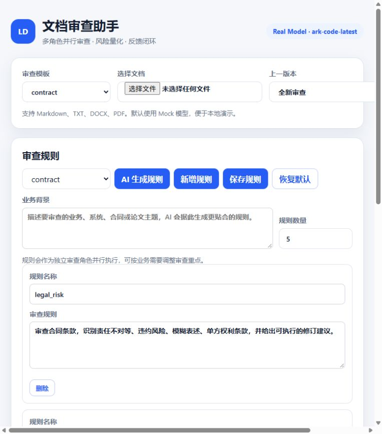

# Lumen Doc Reviewer

Lumen Doc Reviewer 是一个面向合同、技术方案和论文的多角色文档审查系统。它会把文档自动分段，交给多个审查角色并行检查，再对结果去重、评分并生成可下载报告。



> AI 审查结果仅供参考，不能替代法律、安全或专业合规意见。

## 核心功能

| 能力 | 说明 |
|---|---|
| 多格式解析 | 支持 Markdown、TXT、DOCX、PDF |
| 多角色审查 | 每个模板包含多个审查规则，按角色并行审查 |
| 可视化规则管理 | 查看、修改、新增、删除规则，也可让 AI 生成规则草稿 |
| 增量版本对比 | 上传新版本时可指定上一版，只重点审查变更内容 |
| 风险量化 | 聚合去重后计算风险分，标记 critical / major / minor / info |
| 报告导出 | 生成 Markdown 和 HTML 报告 |
| 反馈闭环 | 对每条发现执行采纳、驳回或修改 |
| 审计与删除 | 记录上传、审查、反馈、报告访问和删除事件；会话可安全删除 |

## 界面预览

规则面板支持人工编辑和 AI 生成：


审查完成后可以在界面上查看结构化发现和报告，并通过 `/api/doc/{id}/report?format=markdown|html` 下载。

## 环境要求

- Java 21+
- Maven 3.9+
- 真实模型模式需要一个 OpenAI Chat Completions 兼容 API

## 快速启动

### Mock 模式

Mock 模式不调用外部模型，适合先体验完整流程：

```bash
DOC_REVIEW_MOCK=true mvn spring-boot:run
```

PowerShell 使用：

```powershell
$env:DOC_REVIEW_MOCK="true"
mvn spring-boot:run
```

启动后访问：

```text
http://localhost:8080
```

如果端口被占用，可以指定其他端口：

```bash
mvn spring-boot:run -Dspring-boot.run.arguments=--server.port=18080
```

### 真实模型模式

系统使用 OpenAI Chat Completions 兼容接口。推荐使用通用环境变量：

```bash
export OPENAI_BASE_URL="https://api.openai.com/v1"
export OPENAI_API_KEY="sk-xxx"
export OPENAI_MODEL="gpt-4o-mini"
mvn spring-boot:run
```

项目专用变量优先级更高：

| 配置项 | 优先级 | 默认值 |
|---|---|---|
| Base URL | `DOC_REVIEW_AI_BASE_URL` > `OPENAI_BASE_URL` > 内置默认值 | `https://ark.cn-beijing.volces.com/api/plan/v3` |
| API Key | `DOC_REVIEW_AI_API_KEY` > `OPENAI_API_KEY` > 空 | 空 |
| Model | `DOC_REVIEW_AI_MODEL` > `OPENAI_MODEL` > 内置默认值 | `ark-code-latest` |
| Mock | `DOC_REVIEW_MOCK` | `false` |
| Timeout | `doc-review.ai.timeout-seconds` | `120` |

### PostgreSQL 配置

项目默认连接本机 PostgreSQL：

| 配置项 | 默认值 |
|---|---|
| JDBC URL | `jdbc:postgresql://localhost:15433/lumen_doc_reviewer` |
| 用户名 | `lumen` |
| 密码 | `lumenpw` |

可以使用环境变量覆盖：

```bash
export DOC_REVIEW_DB_URL="jdbc:postgresql://localhost:15433/lumen_doc_reviewer"
export DOC_REVIEW_DB_USERNAME="lumen"
export DOC_REVIEW_DB_PASSWORD="lumenpw"
```

首次启动时，JPA 会自动创建 `document_sessions`、`document_segments`、`doc_findings` 和 `audit_logs` 表。

> 当前 `application.yml` 默认启用真实模型。如果没有配置 API Key，请先设置 `DOC_REVIEW_MOCK=true`。

界面右上角会显示当前模式，例如 `Mock Model` 或 `Real Model · ark-code-latest`。

## 构建与测试

```bash
mvn test
mvn package
```

生成的可执行 JAR：

```text
target/lumen-doc-reviewer-0.1.0-SNAPSHOT.jar
```

运行 JAR：

```bash
java -jar target/lumen-doc-reviewer-0.1.0-SNAPSHOT.jar --server.port=8080
```

## 使用流程

1. 打开 Web 界面。
2. 选择审查模板，如 `contract`、`technical` 或 `paper`。
3. 上传 Markdown、TXT、DOCX 或 PDF 文档。
4. 如需增量审查，在“上一版本”中选择旧版本会话。
5. 等待审查完成后查看发现、分段、报告和审计日志。
6. 对审查发现执行采纳、驳回或修改。

## 审查规则管理

内置模板位于：

```text
src/main/resources/templates/review/
```

| 模板 | 审查方向 |
|---|---|
| `contract.yaml` | 法务风险、合规、商业逻辑 |
| `technical.yaml` | 架构、安全、成本 |
| `paper.yaml` | 论证逻辑、证据、引用 |

界面中的“审查规则”面板可以：

- 查看每个规则名称和审查要求；
- 修改规则内容和规则数量；
- 新增或删除规则；
- 保存后让后续审查立即使用新规则；
- 恢复内置默认规则。

人工修改会写入：

```text
./data/templates/review/{name}.yaml
```

自定义规则优先于内置规则生效；“恢复默认”会删除对应的自定义覆盖文件。

### AI 生成规则

在“审查规则”面板中填写业务背景，例如：

```text
这是一份企业数据安全合规产品 PRD，需要重点审查默认凭据、元数据外发第三方 AI、权限矩阵、审计日志和成本估算。
```

然后设置规则数量并点击“AI 生成规则”。AI 会返回规则草稿，界面会替换当前编辑内容；确认无误后点击“保存规则”才会持久化。

也可以直接调用 API：

```bash
curl -X POST http://localhost:8080/api/doc/templates/contract/generate-rules \
  -H "Content-Type: application/json" \
  -d '{
    "businessContext": "审查企业数据安全合规产品 PRD，关注默认凭据、元数据外发和审计日志。",
    "ruleCount": 5
  }'
```

> AI 生成的规则只是草稿，保存前建议人工确认是否符合业务和合规要求。

## API

| 方法 | 路径 | 说明 |
|---|---|---|
| GET | `/api/doc/mode` | 获取当前模型模式 |
| GET | `/api/doc/templates` | 获取审查模板 |
| GET | `/api/doc/templates/{name}` | 获取模板中的审查规则 |
| POST | `/api/doc/templates/{name}/generate-rules` | 使用 AI 生成审查规则草稿 |
| PUT | `/api/doc/templates/{name}` | 保存审查规则修改 |
| DELETE | `/api/doc/templates/{name}/override` | 恢复内置默认规则 |
| GET | `/api/doc/sessions` | 获取历史审查会话 |
| POST | `/api/doc/upload` | 上传文档，参数 `file`、`template`，可选 `previousSessionId` |
| GET | `/api/doc/{id}/status` | 查询审查进度和风险分 |
| GET | `/api/doc/{id}/segments` | 获取文档分段 |
| GET | `/api/doc/{id}/findings` | 获取结构化审查发现 |
| GET | `/api/doc/{id}/report?format=markdown\|html` | 获取报告 |
| POST | `/api/doc/{id}/feedback` | 提交采纳 / 驳回 / 修改反馈 |
| GET | `/api/doc/{id}/audit` | 获取会话审计日志 |
| DELETE | `/api/doc/{id}` | 删除会话及其分段、发现和本地上传文件 |

### 上传新版本

```bash
curl -X POST http://localhost:8080/api/doc/upload \
  -F "file=@./contract-v2.md" \
  -F "template=contract" \
  -F "previousSessionId={previous-id}"
```

系统会基于旧版本分段做相似度对比，并优先审查变更内容。

### 提交反馈

```bash
curl -X POST http://localhost:8080/api/doc/{id}/feedback \
  -H "Content-Type: application/json" \
  -d '{"findingId":1,"action":"accepted"}'
```

`action` 支持 `accepted`、`rejected`、`modified`。

### 删除会话

```bash
curl -X DELETE http://localhost:8080/api/doc/{id}
```

如果该会话已被后续版本引用，接口会拒绝删除，避免破坏增量版本链。

## 本地数据

当前使用 PostgreSQL 容器数据库。原始文件和自定义规则仍写入本地：

```text
./data/uploads
./data/templates/review
```

| 路径 | 用途 |
|---|---|
| PostgreSQL：`lumen_doc_reviewer` | 保存会话、分段、发现和审计日志 |
| `data/uploads` | 原始上传文件 |
| `data/templates/review` | 自定义审查规则覆盖文件 |

## 常见问题

### 真实模型没有返回结果

检查：

1. `OPENAI_API_KEY` 是否存在；
2. `OPENAI_BASE_URL` 是否指向 Chat Completions 兼容服务；
3. `OPENAI_MODEL` 是否对该账号可用；
4. 网络是否能访问模型服务；
5. 服务日志中是否有 `AI review request failed` 或 `AI rule generation failed`。

### PDF 审查较慢

复杂 PDF 可能被分成更多片段，真实模型模式下每个变更片段都会调用多个审查角色，耗时和 Token 用量会明显增加。建议先用 Markdown/TXT 或较小 PDF 测试。

### 界面显示 Mock Model

表示 `DOC_REVIEW_MOCK=true` 或系统运行在 Mock 模式。真实模型模式会显示 `Real Model · 模型名`。

## 当前范围

已实现：

- 文档解析、分段；
- 多角色并行审查；
- 可视化规则管理和 AI 规则草稿生成；
- 聚合去重、风险评分；
- Markdown / HTML 报告；
- 反馈闭环；
- 版本对比与增量审查；
- 审计日志和会话删除；
- 静态 Web 界面。

暂未实现：

- OCR 和扫描件识别；
- PDF 红线标注；
- Word Track Changes；
- 用户登录与 SSO；
- 消息队列和分布式任务；
- S3 / OSS 对象存储；
- 多租户和细粒度权限管理。
